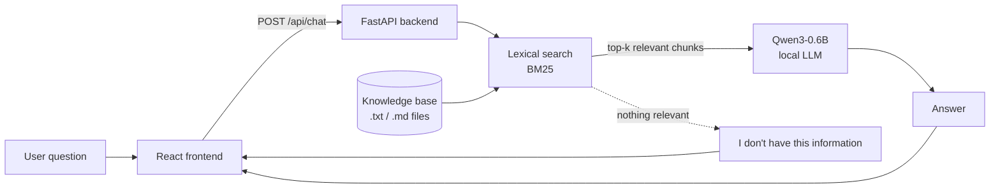

# 1337 Campus Assistant 🤖

> Instant answers about campus rules, procedures, and student life, in one place.

## 📑 Table of Contents

1. [In 30 Seconds](#-in-30-seconds)
2. [The Problem](#-the-problem)
3. [Our Solution](#-our-solution)
4. [Demo](#-demo)
5. [Example Questions and Answers](#-example-questions-and-answers)
6. [How It Works](#-how-it-works)
7. [Design Choices](#-design-choices-and-why-we-made-them)
8. [Tech Stack](#-tech-stack)
9. [Quick Start (For Judges)](#-quick-start-for-judges)
10. [Managing the Knowledge Base](#-managing-the-knowledge-base)
11. [API Reference](#-api-reference)
12. [Troubleshooting](#-troubleshooting)
13. [Limitations](#-limitations)
14. [Roadmap](#-roadmap)
15. [FAQ](#-faq)
16. [Team](#-team)

---

## ⏱️ In 30 Seconds

| | |
|---|---|
| **What is it?** | A chatbot that answers questions about a school (rules, procedures, campus life). |
| **What problem does it solve?** | School information is scattered, so people must ask many people and search many places. |
| **How does it work?** | It finds the relevant passages in the school's documents, then a small AI model writes the answer from them (RAG). |
| **What if it doesn't know?** | It says the answer is not in its knowledge base instead of making something up. |
| **Which school?** | Built and tested on **1337**. Designed to extend to **UM6P** by adding documents. |
| **Does it need the internet?** | Only on first run, to download the model. After that it runs locally. |
| **Where is the demo?** | A video at the root of this repository: [`demo.mp4`](demo.mp4) |

---

## ❗ The Problem

Getting reliable information about a school is harder than it should be.

- **Prospective students and visitors** don't know where to look. They don't know how admission works, what daily life is like, or who to ask.
- **Current students** have to ask many different people and search many different places to find a single answer about rules, procedures, or campus life.
- **The result:** wasted time, confusion, and incomplete or contradictory answers, because each person you ask may know only part of the picture.

There is no single place where someone can simply *ask a question and get an answer*.

---

## ✅ Our Solution

A chatbot that answers questions from a school's **own documents** using **Retrieval-Augmented Generation (RAG)**.

Instead of answering from the AI model's memory, which can be wrong or outdated, the system:

1. **Searches** the school's documents for the passages related to the question.
2. **Gives** those passages to the AI model.
3. **Generates** an answer based on them.

If the documents don't contain the answer, the bot **says so**.

### Why 1337, and what about UM6P?

We built it for **1337** because it is our school and we had data about it. The system is **not hard-coded to 1337**: it answers from whatever documents are in its knowledge base. Adding UM6P documents is how it would be extended to UM6P, with no change to the code.

### Who it's for

| User | Example question |
|---|---|
| Prospective student or visitor | "How does the admission process work?" |
| Current student | "What are the rules about attendance?" |

---

## 🎬 Demo

📹 **Demo video:** [`demo.mp4`](demo.mp4) (at the root of this repository)

The video shows:
1. Starting the backend and frontend.
2. Asking a question that is in the knowledge base and getting an answer.
3. Asking a question that is **not** in the knowledge base and getting an honest "I don't have this information" response.

---

## 💬 Example Questions and Answers

| Question | What the bot does |
|---|---|
| "How does the admission process work?" | Retrieves the admission passages and summarizes them. |
| "What are the rules about attendance?" | Retrieves the rules and answers from them. |
| "Who won the football world cup?" | Not in the knowledge base, so the bot says it doesn't have the information. |

> The third row matters. A chatbot that refuses to guess is more trustworthy than one that answers everything.

---

## ⚙️ How It Works



### Step by step

1. **Ingestion.** The `.txt` / `.md` documents are split into small chunks (pieces of text), because a whole document is too large to give the model.
2. **Indexing.** The chunks are indexed for keyword search.
3. **Question.** The user types a question in the React interface, which sends it to the FastAPI endpoint.
4. **Retrieval.** The backend ranks the chunks by keyword relevance using **BM25** and keeps the top few.
5. **Generation.** The question and the retrieved chunks go to **Qwen3-0.6B**, which is instructed to answer *only* from the provided text.
6. **Fallback.** If no relevant chunk is found, the bot answers that the information is not in its knowledge base.
7. **Response.** The answer is returned as JSON and displayed in the chat.

---

## 🧠 Design Choices (and Why We Made Them)

| Choice | Why | Trade-off |
|---|---|---|
| **RAG** instead of a plain chatbot | Answers come from real school documents, not from the model's memory. Updating knowledge means editing files, not retraining. | Quality depends on the documents and on retrieval. |
| **Lexical search (BM25)** instead of embeddings | Simple, fast, no extra model, easy to understand and debug. Good enough for a demo. | Matches words, not meaning, so a differently worded question can miss the right passage. |
| **Qwen3-0.6B** | Small enough to run locally on a normal machine, with no API key, no cost, and no data sent to a third party. | Small models are less fluent and weaker at reasoning than large ones. |
| **FastAPI** | Lightweight Python backend, automatic interactive docs at `/docs`, and request validation. | None significant for this scale. |
| **React** | Standard, fast way to build a chat interface. | None significant for this scale. |
| **"I don't know" fallback** | Prevents invented answers, which are the biggest risk of a chatbot about rules and procedures. | Some questions will be refused even if a human could answer them. |

---

## 🛠️ Tech Stack

| Layer | Technology |
|---|---|
| Frontend | React |
| Backend | FastAPI (Python), served with Uvicorn |
| Language model | [Qwen3-0.6B](https://huggingface.co/Qwen/Qwen3-0.6B), running locally |
| Retrieval | Lexical search (BM25) |
| Knowledge base | Plain `.txt` and `.md` files |
| Package management | `uv` (Python), `npm` (JavaScript) |

---

## 🚀 Quick Start (For Judges)

### Prerequisites

- Python 3.10+
- Node.js 18+
- [`uv`](https://docs.astral.sh/uv/) (Python package manager)
- Internet connection on the **first run** to download the model (about 1.5 GB)
- A GPU is **not required**. The model runs on CPU, with slower responses.

### 1. Clone the repository

```bash
git clone [repository-url]
cd [repository-folder]
```

### 2. Run the backend (FastAPI)

```bash
cd back-end
uv sync
uv run uvicorn src.api:app --reload
```

- API: http://localhost:8000
- Interactive API docs: http://localhost:8000/docs

> ⏳ The first start can take a few minutes while the model downloads. This is normal.

### 3. Run the frontend (React)

Open a **second terminal**:

```bash
cd front-end
npm install
npm run dev
```

Open the URL printed in the terminal (usually http://localhost:5173).

### 4. Try it

Ask: *"How does the admission process work?"*, then ask something unrelated to see the "I don't have this information" behavior.

---

## 📂 Managing the Knowledge Base

The chatbot only knows what is in its knowledge base. To **add, update, or remove** knowledge, put `.txt` or `.md` files in:

```
back-end/rag/data/raw/vllm-0.10.1
```

Then **restart the backend**. Documents are chunked and indexed at startup.

**Tips for good documents**
- One topic per file, with a clear title.
- Short paragraphs and plain language.
- Use the same words people use in their questions, because retrieval is keyword-based.

---

## 🔌 API Reference

### `POST /api/chat`

**Request**
```json
{
  "question": "How does the admission process work?"
}
```

**Response**
```json
{
  "answer": "..."
}
```

Full interactive documentation: http://localhost:8000/docs

---

## 🩺 Troubleshooting

| Problem | Likely cause and fix |
|---|---|
| First start is very slow | The model is downloading (about 1.5 GB). Wait for it to finish. |
| Responses are slow | The model is running on CPU. This is expected without a GPU. |
| Frontend can't reach the backend | Check that the backend is running on port 8000 and the frontend points to it. |
| `uv: command not found` | Install uv: https://docs.astral.sh/uv/ |
| Added a document but nothing changed | Restart the backend so the documents are re-indexed. |
| The bot says it doesn't know | The information is probably not in the knowledge base, or the question uses different words than the documents. |

---

## ⚠️ Limitations

We prefer to be honest about what this demo is and isn't.

- **Small model.** Qwen3-0.6B has only 0.6 billion parameters, so answers can be less fluent, less precise, and weaker at reasoning than those of larger models.
- **Small knowledge base.** There isn't much data, so many questions fall outside what the bot knows.
- **Keyword matching.** Lexical retrieval matches words, not meaning, so a question phrased differently from the document may miss the right passage.
- **No source citations yet.** Answers do not currently show which document they came from.
- **Not an official source.** For decisions that matter, confirm with school administration.
